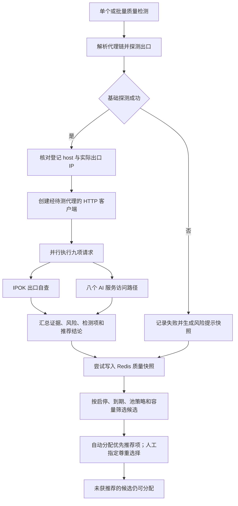

# IP 质量检测逻辑（当前实现）

核对日期：2026-11-06。本文描述仓库当前代码中的行为；部署状态由实际运行版本决定。

## 1. 检测解决什么问题

检测提供基础出口、IP 信誉和 Claude/ChatGPT/Gemini 等访问路径的推荐依据。质量与信誉用于展示和自动分配排序；人工指定代理尊重管理员选择。

| 概念 | 当前含义 |
| --- | --- |
| 库存 / 代理状态 | 新建、导入可以先登记代理；`active` 表示启用状态 |
| 基础连通性 | 经代理拿到出口 IP、地区和延迟 |
| IP 风险分 `reputation.risk_score` | 0–100，越高风险越大；证据不足时为 `null` |
| 综合质量分 `score` | 0–100，越高越好；由检测扣分，并受 IP 风险限制上限 |
| 基础推荐 `base_eligible` | 出口连通、身份一致、当前 IP 信誉风险低于推荐阈值 |
| 分项推荐 `ai_platforms[].eligible` | 基础推荐成立，且该 AI 服务路径取得可识别的无鉴权可达证据 |
| 汇总推荐 `eligible` | 至少一个 AI 路径满足推荐条件 |

以上字段、分数及等级都是推荐指标。低分、证据不足、过期或缓存不可用均不阻止分配、移池或人工换 IP。代理启停、到期、池策略、容量与健康故障处置仍按各自规则执行。分项“可达”描述无鉴权观测，真实登录、账号权限和推理结果须由有效账号验证。

## 2. 完整流程与触发入口



- 管理端「质量检测」触发单个检测；「批量质量检测」由前端以 **3 个代理并发**调用同一个接口。
- 接口：`POST /api/v1/admin/proxies/:id/quality-check`。
- 单个代理内部：基础探测完成后，并发进行一次 IPOK 自查及八个 AI 路径探测。
- 出口身份不一致会增加失败项，后续请求仍会继续，便于展示其他检测结果。
- 创建代理后的异步延迟探测、「测试连接」及落地健康巡检承担连通性职责。自动分配尽力读取已有质量快照进行推荐排序；完整质量检测由上述检测入口触发。

## 3. 出口与平台访问检测

### 3.1 基础出口探测

经该代理的完整链路请求探测站点，返回出口 IP、地区和延迟。内置站点按顺序尝试：

1. `http://ip-api.com/json/?lang=zh-CN`。
2. 第一个失败后尝试 `http://api64.ipify.org?format=json`。

每个基础探测请求超时 **10 秒**。配置 `security.proxy_probe.urls` 后，该列表覆盖内置站点。

基础探测失败直接结束本次检测。成功后进行静态出口身份校验：

- 登记的 `proxy.Host` 必须能解析为 IP 字面量。
- 登记 IP 必须与探测到的出口 IP 一致。
- 比较时统一 IPv4 与 IPv4-mapped IPv6 表示。
- IPOK 自查还会再校验一次它看到的请求出口。

### 3.2 AI 专项探测目标

所有请求均经待测代理发送，使用公开端点，不携带账号 Token、API Key、Cookie，也不执行模型推理。

| 检测项 `target` | 服务与访问面 | 请求 | URL |
| --- | --- | --- | --- |
| `anthropic` | Claude API / Claude Code | GET | `https://api.anthropic.com/v1/models` |
| `claude_web` | Claude 网页入口 | GET | `https://claude.ai/login` |
| `openai` | OpenAI API | GET | `https://api.openai.com/v1/models` |
| `chatgpt` | ChatGPT / Codex 后端 | GET | `https://chatgpt.com/backend-api/models` |
| `gemini` | Gemini API | GET | `https://generativelanguage.googleapis.com/v1beta/models` |
| `gemini_web` | Gemini 网页入口 | GET | `https://gemini.google.com/app` |
| `gemini_code_assist` | Gemini Code Assist | POST，空 JSON 对象 | `https://cloudcode-pa.googleapis.com/v1internal:loadCodeAssist` |
| `grok` | Grok API | GET | `https://api.x.ai/v1/models` |

Gemini 使用实际模型接口替代 Discovery 元数据地址；Claude 使用模型列表接口替代无请求体的 Messages GET。Anthropic 请求携带 `anthropic-version: 2023-06-01`。

每个请求超时 **15 秒**，响应头超时 **10 秒**；API 响应最多读取 **8 KiB**，网页类响应最多读取 **64 KiB**。前端对完整检测接口的等待时间为 **60 秒**。

### 3.3 AI 不利证据的分类与对比

先解析提供方 JSON 错误结构（包括 Google `ErrorInfo.reason`、ChatGPT `detail`），再结合挑战标记、最终跳转 URL、网页可见文字和 HTTP 状态分类。网页脚本与样式中的翻译字符串不作为当前拒绝证据。

| 证据类别 `evidence` | 典型证据 | 分项状态 | 推荐参考 |
| --- | --- | --- | --- |
| `geo_restricted` | OpenAI 不支持国家/地区代码、Gemini 明确 User location 拒绝、Claude 官方地区不可用跳转 | `restricted` | 不推荐该路径 |
| `ip_blocked` | 提供方明确返回 IP blocked 代码或对应拒绝信息 | `restricted` | 不推荐该路径 |
| `waf_challenge` | Cloudflare 挑战响应，记录可取得的 `cf-ray` | `challenge` | 暂无正常访问证据，需复检 |
| `access_denied` | 无明确归因的 403 / 451 | `restricted` | 不推荐该路径，原因保留为未知 |
| `rate_limited` | 429，记录 `Retry-After` | `rate_limited` | 需复检，单次频控不记作 IP 黑名单 |
| `quota_exhausted` | 账号额度、余额或计费限制代码 | `account_limited` | 需账号条件验证，不归因于 IP 欺诈 |
| `account_requirement` | Gemini 免费层的地区/计费前提，或组织 IP allowlist | `account_limited` | 与账号条件有关，保留限制原因 |
| `provider_overloaded` / `network_error` | 5xx、Claude 529、连接失败、读取失败或超时 | `unavailable` | 需复检，不记作确定 IP 风险 |
| `invalid_response` / `unexpected_response` | 无法识别的错误页、响应结构或跨站跳转 | `unknown` | 证据不足，暂不推荐该路径 |
| `authentication_required` | 识别出对应服务的缺少鉴权响应 | `reachable` | 基础推荐成立时可推荐该路径 |
| `api_reachable` | 返回可识别的模型元数据结构 | `reachable` | 仅确认接口访问 |
| `web_reachable` | 正确站点上的提供方公开应用/登录页面 | `reachable` | 仅确认网页入口 |

关键区别：

- 401 必须符合相应提供方错误结构；代理网关生成的任意 401 HTML 作为未知响应处理。
- Gemini 403 的“未注册调用者，请提供 API Key”可证明抵达鉴权边界；泛化 `PERMISSION_DENIED` 仍作为未明确归因的拒绝。
- Gemini “免费层在该国家不可用，请启用计费”归到账号前提；明确“User location is not supported”归到地区限制。
- HTTP 200 中的明确业务拒绝仍会被识别。HTML 正文按去除脚本、样式后的文本判断：明确 IP 封锁记为 `ip_blocked`，含 `Access denied` 的品牌网页保留为未知响应。
- 响应证据归属于原探测站点，跨站页面保留为未知。Claude 跳转至 HTTPS 官方 `claude.com/app-unavailable-in-region` 是已知地区限制的例外。
- 单个来源的邮件黑名单与通用代理标签仍由第 4 节的基础风险策略处理；AI 专项证据保留为独立分项。

## 4. IP 风险证据怎么取得

### 4.1 经代理查询自己

复用平台访问检测所使用的代理客户端，请求：

```text
GET https://ipok.io/api/ip
Accept: application/json
Accept-Version: 1
User-Agent: sub2api-ip-quality/1.0
```

请求不带 `ip` 参数。IPOK 按请求来源识别出口，返回的 `geo.ip` 必须与基础探测出口一致。IPOK 请求同样走已配置的前置链路和落地代理。

IPOK 负责第三方来源的采集、共享缓存、多源加权聚合及上游风险下限；sub2api 负责证据验收、本地下限保护和池准入。自查响应可能包含共享缓存，本地按来源的 `observedAt` 判断时效。

### 4.2 证据验收条件

以下条件全部满足，才把本地信誉状态记为 `current`，提供数值风险分：

- 请求成功、HTTP 200、响应为有效 JSON，响应体不超过 **512 KiB**。
- 目标出口通过公网地址检查，返回的 `geo.ip` 与预期出口一致。
- `riskAssessment.version == 1`，且 `scoreAvailable == true`。
- 上游状态为 `current` 或 `limited`。
- `staleSources`、`undatedSources`、`invalidSources` 均为空。
- `assessedAt` 可解析，距本次信誉请求开始不超过 24 小时；未来时间最多容忍 1 分钟时钟偏差。
- 风险总分为 0–100 的有效数值。

对 `ok == true` 的来源按来源名去重，随后校验其中的数值风险来源：必须被上游列入 `currentSources`，分数在 0–100，观测时间可解析、距信誉请求开始 **小于 72 小时**，未来偏差最多 1 分钟。任一被校验的数值来源不满足条件，整次信誉结果转为证据不足。

`IPinfo Lite` 与 `IPOK-DB` 不参与本地数值来源的覆盖和日期校验；离线库的有效性由上游评估负责。当前数值证据至少覆盖以下两类，各有一个来源：

| 覆盖类别 | 可满足该类别的来源 |
| --- | --- |
| 匿名代理识别 | Scamalytics、proxycheck、IPHub、vpnapi.io、IPQS |
| 滥用记录 | AbuseIPDB、ipapi.is、StopForumSpam |

厂商名称不同表示来自不同接口，底层数据独立性仍未验证。

### 4.3 DNSBL 与硬信号下限

IPv4 还要求 IPOK 返回的 DNSBL `checked > 0`、`total > 0`，且 `checked == total`。部分查询失败也会被本地严格策略判为证据不足。IPv6 跳过这项完整性要求。

证据验收后，从上游 `risk` 开始，取它与所有 `riskBreakdown.floors` 的最大值；再根据聚合后的信号保证以下本地下限：

| 聚合信号 | 风险分下限 |
| --- | --- |
| `tor` | 90 |
| `blacklist` / `blocklisted`，或 `blocklist.listed` 非空 | 70 |
| `proxy` / `vpn` | 65 |
| `abuser` / `abuse` | 55 |

本地使用 IPOK 的聚合信号，单个来源的原始 proxy/VPN 标记由 IPOK 按其规则处理。机房用途、白名单、同网段环境等其他下限沿用上游结果。

最终 **风险分 ≥50 标记为不推荐**；低于 50 且连通性、身份和时效证据齐全时可满足基础推荐条件。人工仍可选择未获推荐的 IP。

## 5. 综合质量分、等级与状态

设 `W` 为告警项数，`F` 为失败项数，`C` 为挑战项数，`R` 为验收并应用下限后的 IP 风险分：

```text
检测基础分 = max(0, 100 - 10×W - 22×F - 30×C)
综合质量分 = min(检测基础分, 100 - R)
```

基础出口、IP 信誉及八个 AI 路径均形成检测项；正常全通过时有 10 个通过项。出口身份异常增加失败项。IP 信誉未知计为告警，风险达到不推荐阈值计为失败；AI 各分项按上述证据分类计为通过、失败、挑战或告警。

| 综合质量分 | 展示等级 |
| --- | --- |
| 90–100 | A |
| 75–89 | B |
| 60–74 | C |
| 40–59 | D |
| 0–39 | F |

信誉证据不足时，接口返回质量 `score=0`、`grade=Unknown`、风险 `risk_score=null`；前端隐藏两种总分，显示「风险证据不足」。

基础推荐成立且至少一个 AI 路径可推荐时，存在其他失败/挑战/告警则汇总状态为 `warn`，全部正常为 `healthy`。缺少可推荐 AI 分项时，按挑战、失败、告警顺序展示汇总异常。自动分配按账号对应分项优先推荐，其他资源可用候选仍可兜底。

以下为公式推导示例，假设除所列异常外其余检测均通过：

| 场景 | IP 风险 R | 综合质量分 | 等级 | 分项推荐 |
| --- | --- | --- | --- | --- |
| 所有路径取得可达证据 | 12 | 88 | B | 推荐各已验证路径 |
| Claude API 地区拒绝，Gemini API 可达 | 0 | 78 | B | 不推荐 Claude API；推荐 Gemini API |
| ChatGPT 挑战，OpenAI API 可达 | 0 | 70 | C | 不推荐 ChatGPT/Codex；推荐 OpenAI API |
| 某路径一次 429 | 0 | 90 | A | 该路径待复检；其他已验证路径单独判断 |
| 命中 Tor，信誉项失败 | 90 | 10 | F | 不推荐，人工仍可指定 |
| 信誉证据不足 | 未知 | 隐藏 | Unknown | 推荐依据不足，人工仍可指定 |

## 6. 分配与人工指定如何使用结果

### 6.1 基础推荐与 AI 分项

`base_eligible=true` 要求当前信誉证据可用且风险低于 50、基础出口探测成功、登记与实际出口一致。AI 分项异常不改变这个基础推荐标记。

`ai_platforms[].eligible=true` 进一步要求该路径状态为 `reachable`、检测项为 `pass`。汇总 `eligible` 表示至少一个分项可推荐；这些字段均不作为绑定门槛。

### 6.2 按账号实际路径选择

| 账号使用方式 | 推荐排序参考的 AI 分项 |
| --- | --- |
| OpenAI API Key / upstream | `openai` |
| OpenAI OAuth / setup-token（ChatGPT/Codex） | `chatgpt` |
| Anthropic API / OAuth / setup-token（Claude Code） | `anthropic` |
| Gemini API Key / upstream，或 OAuth 的 `project_id` 去空白后为空 | `gemini` |
| Gemini OAuth 的 `project_id` 去空白后非空（含 `ai_studio`、`code_assist`、`google_one` 及旧账号） | `gemini_code_assist` |
| Grok 已支持接入方式 | `grok` |
| Bedrock、Vertex / service_account、明确的第三方端点及未覆盖平台 | 仅参考基础 IP 推荐，专项访问能力未验证 |

网页入口的观测独立展示。Claude Code 参考 API 分项；Gemini API、Gemini Code Assist 与 Gemini 网页分别展示。已覆盖平台的未知接入类型没有匹配的专项推荐。

Gemini OAuth 按最终凭据中的 `project_id` 选择推荐参考路径：有项目时参考 Code Assist，并忽略 `base_url`；无项目时参考 Gemini API，明确的第三方 `base_url` 只参考基础 IP 结论。未知 `oauth_type` 没有匹配的专项推荐。

Grok 分项当前探测 `api.x.ai`。Grok CLI 专用主机（如 `cli-chat-proxy.grok.com`）未直接探测，因此这里提供 Grok API 的推荐证据。OAuth 的无效 `base_url` 按转发逻辑回落官方地址，参考 `grok` 分项。

OAuth 预览接口携带账号 `type`，Gemini 同时携带 `oauth_type` 和可选 `project_id`；默认按 OAuth 处理。省略 `project_id` 表示授权前尚未知晓项目，此时仅 `code_assist` / `google_one` 参考 Code Assist 分项引导项目发现。空字符串表示已知无项目，参考 Gemini API（或第三方端点）；非空项目参考 Code Assist。建号、池分配和自动换 IP 按最终账号凭据选择推荐路径。

OAuth 预览受资源与池策略约束；质量推荐不足时仍可返回候选。资源或策略错误导致预览失败时，授权界面展示原因并停止后续授权或建号。

### 6.3 推荐排序与手动选择

推荐快照满足以下条件时，可参与自动分配的优先排序：

- 最近连通性 `Success=true`，`QualityBaseEligible=true`。
- 检测时间处于当前时间往前 24 小时内，截止时间尚未到期。
- 代理配置指纹未改变，登记 IP 与缓存探测出口一致。

已覆盖的 AI 路径还参考 `QualityAIPlatforms` 中准确匹配的分项，推荐要求其 `Eligible=true`、`Status=reachable`。其他服务的失败与全局 `QualityStatus` 不替代这个推荐判断。

自动分配先保留符合启停、到期、平台/分组策略及历史和当前账号数上限的候选，再优先当前推荐项；每个推荐层内沿用原平台策略排序。换 IP 候选继续排除未恢复故障和当前代理。

人工指定可用代理时直接采用该选择，包括新建、编辑、批量编辑和换 IP；质量评分与缓存均不参与拒绝判断。直接绑定继续校验代理存在、启用和未过期；池内选择继续遵守池策略、容量、锁定及影子账号规则。账号类型和凭据变化不会触发质量硬拦截。移池校验目标池与代理存在，不要求质量检测。

缓存缺失、读取失败、旧版快照、目标分项缺失或快照过期时，代理保留在候选中，自动分配退回平台策略排序。候选地区信息读取失败也不阻止换 IP。

质量检测与测试连接是管理员主动取得建议的入口。管理员可在检测前指定代理；缺少当前信誉证据时显示风险提示，仍可创建或换绑。

## 7. 快照保存与失效

Redis 键为 `proxy:latency:<proxy_id>`，保存连通性、质量摘要、基础推荐、各 AI 分项结论、配置指纹和有效截止时间。该键没有 Redis TTL，服务层按快照字段判断推荐证据是否仍有效；缺少基础标记的旧快照保留为未获推荐。

推荐证据有效期取以下时间的最早值，到截止点停止优先推荐，代理仍可分配：

```text
完整质量检测开始时间 + 24 小时
本次信誉请求开始时间 + 24 小时
IPOK assessedAt + 24 小时
每个参与本地日期校验的数值来源 observedAt + 72 小时
```

配置指纹覆盖协议、host、端口、用户名、密码、规范化前置模式、前置组 ID 和协议参数。名称、所属池、到期提醒等非链路字段不进入指纹；代理启停、过期另由候选规则约束。

普通连接探测更新最新连通性及出口信息，同时保留原质量时间和截止时间，因此不会为旧信誉续期。最新连接失败或出口改变，会使质量快照失去推荐资格；实际健康故障由巡检单独处置。

完整检测接口返回逐源证据、分项结论和详细检测项；Redis 保存基础推荐、AI 分项和摘要。报告展示服务、API/网页/Code Assist、证据类别、HTTP 状态、观测时间、跳转地址、错误代码与 `Retry-After`，并保留 IPOK 来源回链。

## 8. 当前边界与已知限制

- **推荐与资源规则。** 质量、信誉和 AI 路径观测都是推荐指标；资源存在、启停、到期、池策略、容量和故障处置各按现有规则执行。
- **认证与推理范围。** 探测全程不使用账号凭据。鉴权边界、元数据与网页入口可达属于访问观测，真实登录、订阅权限、生成请求及登录后才出现的地区限制仍需有效账号验证。
- **非官方或未覆盖路径。** 第三方中转、Bedrock、Vertex 等仅参考基础 IP 推荐；固定探测结果不证明这些其他端点可用。
- **复检由管理端触发。** 完整检测可更新推荐证据；普通巡检处理连通性与故障，不自动续期信誉证据。证据过期期间仍可分配代理。
- **既有绑定保留。** 单独执行质量检测失败、快照到期或出现新风险时，不据此移出库存、解绑或暂停账号。健康故障处置属于另一套机制。
- **快照写失败只记录日志。** 检测报告仍会返回，自动排序参考实际读到的缓存。若新风险结果写入失败而旧有效快照仍可读取，旧快照可能继续被推荐。
- **外部额度和覆盖有限。** 按 [IPOK 开发者文档](https://ipok.io/developers)，未验证自查额度为各来源 IP 每 UTC 日 20 次，IPv6 按 /64 合并。各出口自查分开计数，仍受上游共享小时池、供应商限额与缓存新鲜度影响。上游 DNSBL 当前只覆盖 IPv4。
- **检测描述 IP 层证据。** 这里验证特定探测接口的访问结果及观测到的 IP 风险，账号、设备、行为和平台内部政策仍会影响实际业务结果。

## 9. 代码与方法来源

- [完整检测、目标响应分类、评分与快照合并](../backend/internal/service/admin_proxy.go)：`CheckProxyQuality`、`runProxyQualityTarget`、`finalizeProxyQualityResult`、`saveProxyLatency`。
- [风险验收、硬信号下限、指纹及快照推荐](../backend/internal/service/proxy_reputation.go)：`fetchProxyIPReputation`、`assessProxyIPReputation`、`proxyQualityRecommendedForTarget`。
- [AI 目标、错误结构与分项证据](../backend/internal/service/proxy_ai_quality.go)：`proxyQualityTargets`、`classifyProxyAIResponse`、`assessProxyAIPlatforms`。
- [账号推荐路径选择及直接绑定资源校验](../backend/internal/service/proxy_account_admission.go)：`proxyQualityTargetForAccount`、`checkAccountProxyAvailable`。
- [基础出口探测](../backend/internal/repository/proxy_probe_service.go)：`ProbeProxy`。
- [池分配与移池](../backend/internal/service/proxy_pool.go)：`pickProxy`、`AssignProxies`。
- [换 IP 与健康故障处置](../backend/internal/service/proxy_egress_health.go)：`replaceCandidates`。
- [直接绑定代理的账号路径](../backend/internal/service/admin_account.go)：`CreateAccount`、`UpdateAccount`。
- [Redis 快照实现](../backend/internal/repository/proxy_latency_cache.go)。
- [管理端质量报告](../frontend/src/views/admin/ProxiesView.vue)。
- [代理与出口 IP 总体模型](PROXY_IP_MODEL.md)。
- [IPOK 评分方法](https://ipok.io/methodology)与[公开 API 契约](https://ipok.io/developers)。
- [OpenAI 错误代码](https://developers.openai.com/api/docs/guides/error-codes)、[Gemini API 错误](https://ai.google.dev/gemini-api/docs/generate-content/api-errors)、[Anthropic 错误结构](https://github.com/anthropics/anthropic-sdk-python/blob/main/src/anthropic/_exceptions.py)。
